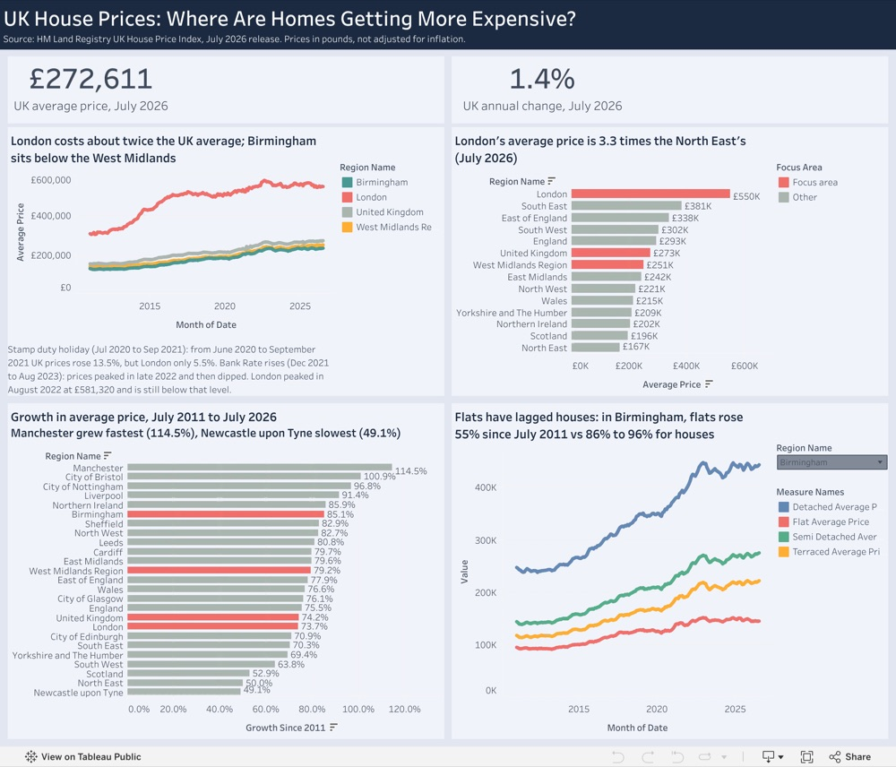
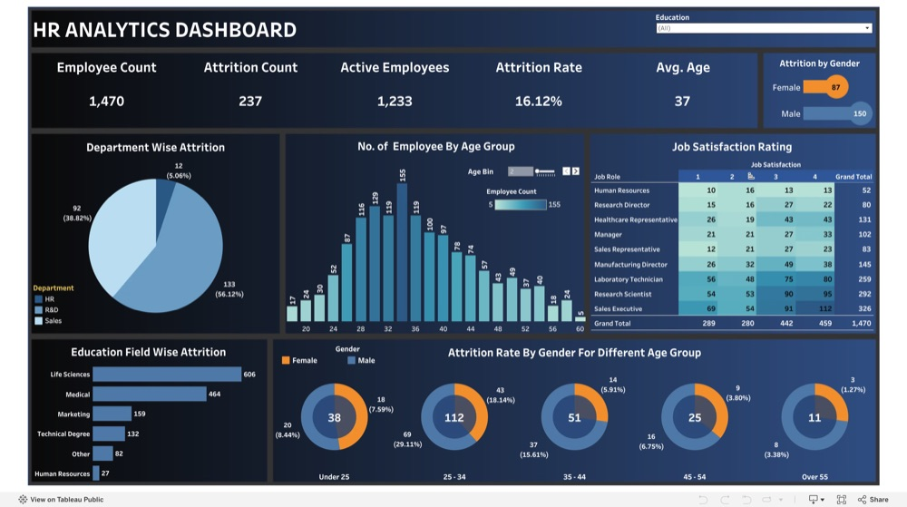
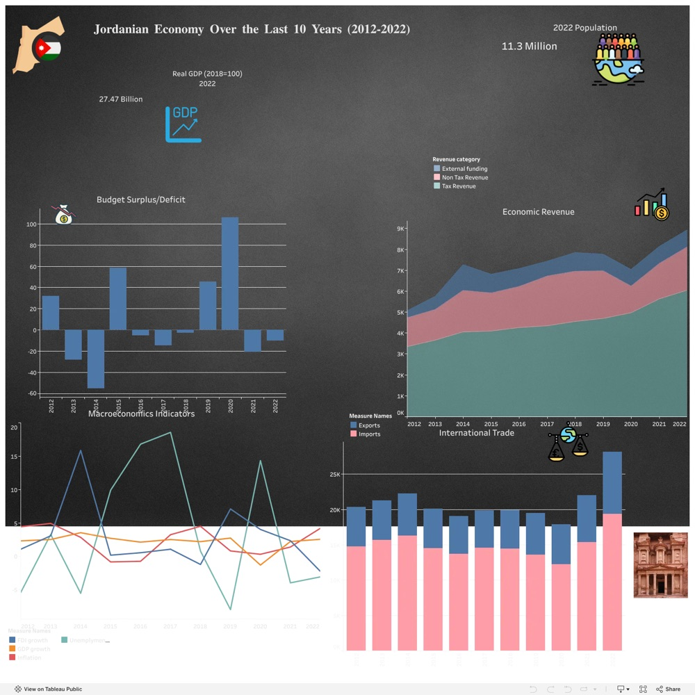
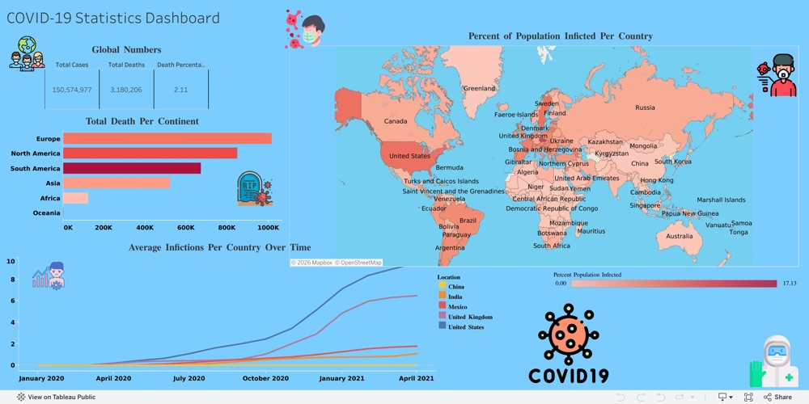
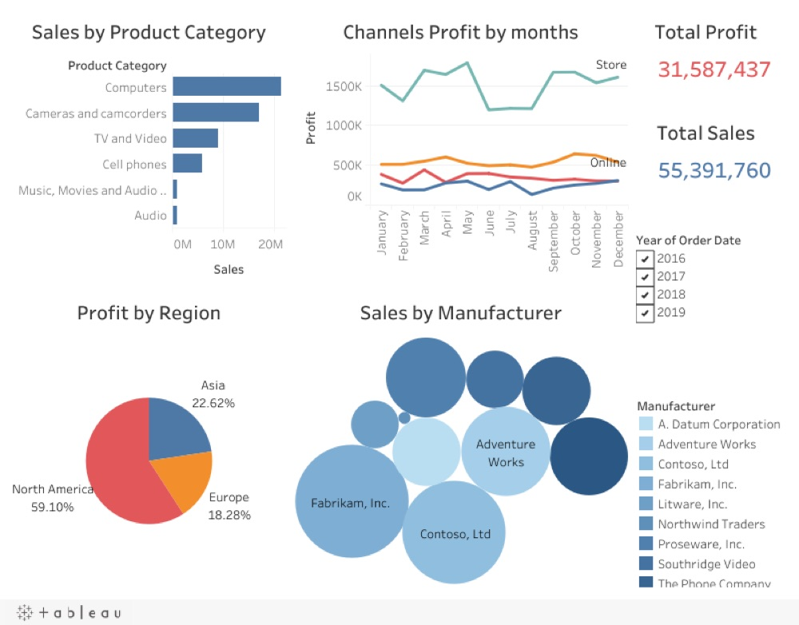
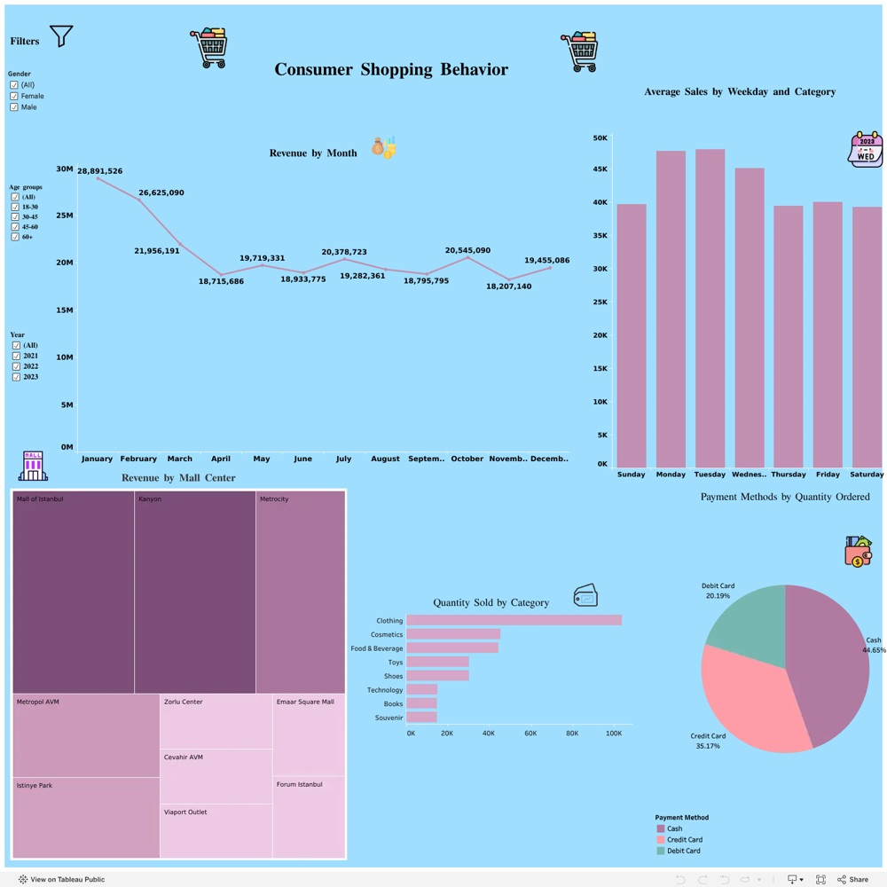
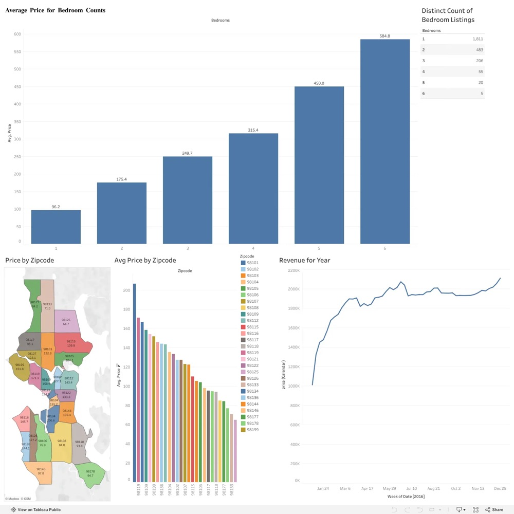
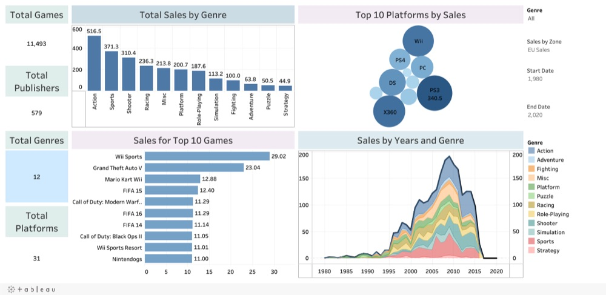

# Tableau Dashboards

Dashboards I built in Tableau Public. Click an image to open the interactive version.

**Full profile:** [public.tableau.com/app/profile/tasneem.bani.khaled](https://public.tableau.com/app/profile/tasneem.bani.khaled)

<table>
<tr>
<td width="50%" valign="top">

 <b>UK House Prices: Where Are Homes Getting More Expensive?</b>
 UK HM Land Registry House Price Index. Regional prices, annual change and growth since 2011, with a focus on Birmingham and the West Midlands.
</td>
<td width="50%" valign="top">

 <b>HR Analytics Dashboard</b>
 Employee attrition by department, age group, education field and gender, with job satisfaction ratings.
</td>
</tr>
<tr>
<td width="50%" valign="top">

 <b>Jordanian Economy, 2012-2022</b>
 Real GDP, budget surplus/deficit, government revenue, international trade and macroeconomic indicators over ten years.
</td>
<td width="50%" valign="top">

 <b>COVID-19 Statistics Dashboard</b>
 Global cases and deaths, deaths by continent, share of population infected by country, and infection trends over time.
</td>
</tr>
<tr>
<td width="50%" valign="top">

 <b>Sales Dashboard</b>
 Sales and profit by product category, region, manufacturer and channel, with monthly profit trends.
</td>
<td width="50%" valign="top">

 <b>Consumer Shopping Behaviour</b>
 Monthly revenue, sales by weekday and category, revenue by shopping mall and payment method.
</td>
</tr>
<tr>
<td width="50%" valign="top">

 <b>Airbnb Listings</b>
 Average price by number of bedrooms and by zip code, mapped, with revenue over time.
</td>
<td width="50%" valign="top">

 <b>Video Game Sales</b>
 Sales by genre, platform and year, with the top 10 best-selling games.
</td>
</tr>
</table>
